# Lern-Periode-2

# 16.10.2026 | Projekt: Number Guesser

## Heute

Ich habe den Number Guesser neu programmiert. Der Computer denkt sich eine Zahl von 1 bis 100 aus. Ich rate, und der Computer sagt mir, ob die Zahl grösser oder kleiner ist. Mit einer Schleife kann ich so lange raten, bis ich die Zahl finde.

Ich hatte einige Fehler: Ich habe einen falschen Namen benutzt, Semikolons an falschen Stellen gesetzt und `else` falsch geschrieben. Ausserdem lief das Programm endlos, weil die Eingabe an der falschen Stelle stand.

Gelernt habe ich:
- Bei `Next(1, 101)` ist die 101 nicht dabei, die Zahlen gehen also nur bis 100.
- Eine Variable muss ich vor der Schleife erstellen.
- Die Eingabe muss in der Schleife stehen, damit ich jedes Mal neu raten kann.

**Status:** noch nicht fertig – ich muss das Programm noch testen.

Der Computer denkt sich eine Zahl aus. Du rätst, und der Computer sagt dir, ob die Zahl grösser oder kleiner ist. Das geht so lange, bis du die richtige Zahl hast.

## Nächstes Mal

- [x] Verstehen, was `int tipp = 0;` bedeutet, und das Programm testen
- [x] Die Versuche zählen und am Ende anzeigen
- [x] Falsche Eingaben abfangen (z. B. Buchstaben)
- [x] Code aufräumen und einen Screenshot machen

Danach will ich einen Budget Manager programmieren.

# 23.10.2026 | Projekt: Number Guesser

## Heute
Ich habe die 4 Punkte vom letzten Mal gelöst. `int tipp = 0;` hab ich verstanden: das ist nur ein Startwert, der sicher nicht die gesuchte Zahl ist, damit die Schleife überhaupt beginnt.

Dann habe ich einen Versuchszähler eingebaut, der bei jedem gültigen Tipp hochzählt. Ausserdem fange ich jetzt falsche Eingaben ab (z. B. Buchstaben) mit `int.TryParse` statt `Convert.ToInt32` – das Programm stürzt also nicht mehr ab, sondern fragt einfach nochmal. Zum Schluss habe ich den Code aufgeräumt und eine unnötige `using`-Zeile entfernt.

**Status:** fertig – das Programm zählt die Versuche und stürzt bei falscher Eingabe nicht mehr ab.

**Programmbeschreibung:** Der Computer denkt sich eine Zahl aus. Du rätst, und der Computer sagt dir, ob die Zahl grösser oder kleiner ist, bis du sie richtig hast. Am Ende siehst du, wie viele Versuche du gebraucht hast.

## Nächstes Mal
- [x] Mit dem Budget Manager starten

# 23.10.2026 | Projekt: Budget Manager

## Heute
Heute habe ich mit meinem neuen Projekt, dem Budget Manager, angefangen. Ich mache es als Konsolen-App in C#.

Zuerst habe ich mir überlegt, welche Daten mein Programm braucht, und dafür Variablen erstellt: Einnahmen, Ausgaben, Name vom Sparziel, Betrag vom Sparziel, wie viel ich schon gespart habe und den Dateinamen zum Speichern.

Ich habe gelernt, dass man für Geld `decimal` nimmt und nicht `double`, weil `decimal` genauer rechnet. Ausserdem habe ich gelernt, was `string dateiPfad = "budget.txt";` bedeutet: Die Variable speichert den Namen der Datei, und die Datei liegt im gleichen Ordner wie das Programm.

Dann habe ich den Code geschrieben, der beim Start die Daten aus der Datei lädt. Mit `File.Exists` prüfe ich, ob die Datei schon da ist. Mit `File.ReadAllLines` lese ich alle Zeilen in ein Array, und mit `decimal.Parse` mache ich aus dem Text wieder Zahlen. Dabei habe ich gemerkt, dass die Reihenfolge der Zeilen sehr wichtig ist.

Ich hatte einen Fehler: Ich habe die Variable `zeile` genannt, aber danach `zeilen` geschrieben.

**Status:** Variablen und Laden aus der Datei sind geschrieben. Menü fehlt noch. Es hat sehr lang gedauert, weil ich dieses YouTube Tutorial schauen musste: https://www.youtube.com/watch?v=GsBqMESx1SA

## Programmbeschreibung
Der Budget Manager ist ein Programm, mit dem ich meine Einnahmen und Ausgaben eintragen kann. Es zeigt mir, wie viel Geld ich noch übrig habe. Ich kann auch ein Sparziel festlegen (z. B. ein Auto) und sehen, wie viel ich schon habe und wie viel noch fehlt. Das Programm speichert alles in einer Datei, damit die Daten beim nächsten Mal noch da sind.

## Nächstes Mal
- [x] Fehler `zeile` / `zeilen` korrigieren
- [x] Menü mit `while`-Schleife bauen (1 bis 5)
- [x] Falsche Eingaben abfangen
- [x] Einnahme und Ausgabe eintragen
- [x] Übersicht anzeigen

# 30.10.2026 | Projekt: Budget Manager

## Heute
Ich habe die 5 offenen Punkte vom letzten Mal gelöst: den Fehler mit `zeile`/`zeilen` korrigiert, ein Menü mit einer `while`-Schleife (Auswahl 1 bis 5) gebaut, falsche Eingaben mit `TryParse` abgefangen, und das Eintragen von Einnahmen und Ausgaben sowie die Übersicht eingebaut.

Ich habe mich aber entschieden, das Projekt jetzt zu pausieren, weil ich zuerst am Morsecode-Projekt weiterarbeiten will. Den Budget Manager mache ich später fertig.

**Status:** pausiert – Lösung für die 5 Punkte ist vorhanden, muss ich nur noch einbauen und testen, wenn ich weitermache.

**Programmbeschreibung:** Der Budget Manager ist ein Programm, mit dem ich meine Einnahmen und Ausgaben eintragen kann. Es zeigt mir, wie viel Geld ich noch übrig habe. Ich kann auch ein Sparziel festlegen und sehen, wie viel ich schon habe und wie viel noch fehlt.

## Nächstes Mal
- [x] Lösung einbauen und testen
- [x] Code aufräumen
- [x] Mit dem Morsecode-Projekt starten

# 30.10.2026 | Projekt: MorseCode

## Heute
Ich habe mit dem Morsecode-Projekt angefangen und die Codetabelle erstellt, die Buchstaben, Zahlen und Sonderzeichen auf Morsecode abbildet.

**Status:** gestartet – Grundgerüst (Form, Codetabelle, Audio-Datei) steht. Ich habe diese Video angeschaut: https://www.youtube.com/watch?v=ObcGBT4ZWEU&t=127s, https://www.youtube.com/watch?v=dYkpTvgCclo&pp=ygUQTW9yc2UgQ29kZSBpbiBDI9IHCQkrDAGHKiGM7w%3D%3D

## Ausblick
Als Nächstes geht's an die eigentliche Übersetzungslogik und die Benutzeroberfläche, danach an Lern-Modus und Chat-Funktionen.

## Nächstes Mal (5 Arbeitspakete)
- [x] Übersetzer Text ↔ Morse mit der Codetabelle fertigstellen
- [x] Form1-Oberfläche bauen (Textfeld, Übersetzen-Button, Anzeige)
- [x] MorseAudio fertigstellen (Signalton für Punkt/Strich abspielen)
- [x] Eingabe über die Leertaste einbauen (kurz = Punkt, lang = Strich)
- [x] Lern-Modus einbauen

# Lern-Periode-2

# 06.11.2026 | Projekt: Morse-Übersetzer

## Heute

Ich habe den Morse-Übersetzer fertig gemacht. Er übersetzt Text in Morsecode und zurück und kann den Code als Ton abspielen. Mit der Leertaste kann ich selbst morsen: kurz ist ein Punkt, lang ein Strich. Im Lern-Modus übe ich die Buchstaben. Dabei hatte ich grosse Hilfe von KI.

Ich hatte einige Fehler: Die Codetabelle stand in der falschen Datei, und die Umlaute waren kaputt.

Gelernt habe ich:
- Ein Strich ist 3-mal so lang wie ein Punkt.
- Mit einer `Stopwatch` messe ich, wie lange die Leertaste gedrückt ist.

**Status:** fertig – den Ton und die Leertaste muss ich noch testen.

## Nächstes Mal

- [x] Den Ton und die Leertaste testen
- [x] Mit Hilfe der KI den Code besser verstehen
- [x] Den Punktestand im Lern-Modus speicher     
- [x] Einen kleinen Teil des Codes selbst ohne KI ändern

Danach will ich im Lern-Modus ganze Wörter üben.

# 06.11.2026 (Nachmittag) | Projekt: Morse-Übersetzer

## Heute

Ich habe die Ziele von heute Morgen bearbeitet. Ich habe den Ton und die Leertaste getestet, und der Lern-Modus speichert jetzt meinen Punktestand. Auch die neue Erklärung zum Code habe ich gelesen. Dabei hatte ich wieder grosse Hilfe von KI.

Ich hatte einen grossen Fehler: Die Leertaste hat nicht funktioniert. Das Feld blieb gelb, und es kam kein Buchstabe. Der Grund war, dass das Stoppen des Tons fast 1 Sekunde gedauert hat und das Programm so lange eingefroren war.

Gelernt habe ich:
- `SoundPlayer.Stop()` ist zu langsam. Mit `waveOut` von Windows stoppt der Ton sofort.
- Mit JSON kann ich den Punktestand in einer Datei speichern und beim Start wieder laden.

**Status:** fertig – die Leertaste erkennt jetzt „SOS SOS“ richtig.

## Nächstes Mal

- [x] Einen kleinen Teil des Codes selbst ohne KI ändern
- [x] Mit Hilfe der KI die Datei `MorseAudio.cs` besser verstehen
- [x] Den Ton selbst anhören und die beste Tonhöhe finden
- [x] Im Lern-Modus alle 5 Stufen ausprobieren

Danach will ich im Lern-Modus ganze Wörter üben.

# 13.11.2026 | Kurs: Networking Basics (Cisco Networking Academy)

## Heute
Ich habe heute nicht programmiert, sondern am Networking-Basics-Kurs weitergemacht. Ich habe Modul 2 komplett fertig gemacht.

**Status:** Modul 2 abgeschlossen, Quiz mit 100%.

## Zusammenfassung
Modul 2 ist durch – damit sind jetzt die ersten zwei Module vom Kurs erledigt.

## Ausblick
Als Nächstes kommt Modul 3. Die Module bauen vermutlich aufeinander auf, also lohnt es sich, bei Unklarheiten kurz in Modul 2 zurückzuschauen, bevor es weitergeht.

## Nächstes Mal
- [x] Mit Modul 3 starten
- [x] Bei Bedarf Modul 2 nochmal repetieren
- [x] Am Morsecode-Projekt weitermachen (pausiert)

# 20.11.2026 | Projekt: Morsecode-Programm (Chat)

## Heute
Ich habe heute mit Claude meine Morsecode-Projektdateien direkt am Laptop durchgeschaut, um zu sehen, wie weit der Chat-Teil schon ist. Dabei habe ich gesehen, dass ich den WLAN-Chat, den Internet-Chat und sogar einen Browser-Chat mit QR-Code schon fertig eingebaut habe, inklusive Verschlüsselung der Nachrichten.

**Status:** Chat-Funktion (WLAN, Internet, Browser/QR) ist fertig und ins Programm eingebaut.

## Zusammenfassung
Übersetzer, Lern-Modus mit Fortschritt, Morsetaste mit Ton und Design sind fertig. Der Chat ist schon viel weiter als geplant: WLAN, Internet und sogar ein Browser-Chat mit QR-Code funktionieren bereits, und die Nachrichten sind verschlüsselt.

## Ausblick
Als Nächstes will ich das Programm mit Freunden in der Praxis testen, um zu sehen, wo es noch Fehler gibt. Danach will ich die Ton-Einstellungen verbessern, eine neue Übung mit ganzen Wörtern einbauen, den Chatverlauf speichern können und am Schluss eine fertige .exe mit Anleitung machen.

## Nächstes Mal
- [x] Praxistest mit Freunden machen
- [x] Ton-Einstellungen verbessern
- [x] Übung mit ganzen Wörtern einbauen
- [x] Chatverlauf speichern
- [x] Fertige .exe + Anleitung erstellen

# 20.11.2026 (Nachmittag) | Projekt: Morse-Übersetzer

## Heute
Der Chat war nur im alten Projekt `MorseCode`. Ich habe ihn in den Morse-Übersetzer übernommen, er ist ein neuer Tab „Chat“. Ausserdem habe ich die Ton-Einstellungen verbessert (Lautstärke und längere Pausen), eine Übung mit ganzen Wörtern eingebaut und den Chatverlauf speicherbar gemacht. Am Schluss habe ich eine fertige `Morse.exe` mit Anleitung erstellt. Dabei hatte ich wieder grosse Hilfe von KI.

Weil mein Repository unordentlich war, hat das Programm jetzt ein eigenes Repository: **https://github.com/MGK-onsta1/Morse-Uebersetzer**. Dort gibt es auch die fertige `.exe` zum Herunterladen.

Ich hatte einen Fehler: Im Chat-Tab war ein Button über einer Checkbox. Ich habe die Texte kürzer gemacht.

Gelernt habe ich:
- Mit `dotnet publish` und `--self-contained` wird eine `.exe` gemacht, die auch ohne installiertes .NET läuft.
- Wenn man nur die Pausen länger macht (Farnsworth-Methode), hört man die Buchstaben beim Lernen besser.

**Status:** fertig – 24 automatische Tests sind ok. Mit echten Freunden habe ich den Chat noch nicht getestet.

## Zusammenfassung
Das Morse-Programm hat jetzt alles, was ich geplant hatte: Übersetzer, Leertasten-Eingabe, Lern-Modus mit Zeichen und Wörtern, verschlüsselten Chat (WLAN, Browser/QR-Code, Internet), Ton-Einstellungen und eine fertige `.exe` mit Anleitung.

Ausserdem habe ich im Cisco-Kurs mit Modul 3 angefangen (Wireless and Mobile Networks).

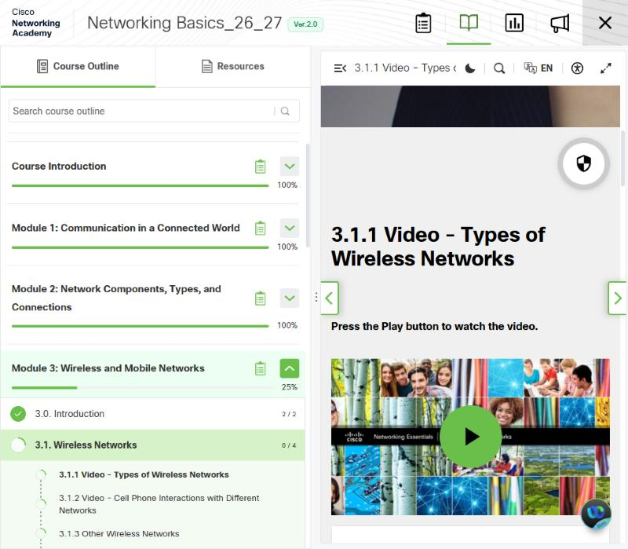

## Ausblick
Als Nächstes will ich den Chat mit echten Laptops und Handys testen und die Fehler beheben, die dabei auftauchen. Danach soll man im Chat direkt mit der Leertaste morsen können, und ich will meinen Code besser verstehen.

## Nächstes Mal (4 Arbeitspakete)
- [x]  Praxistest mit Freunden:** Chat über WLAN, Handy-Browser und Internet-Link testen und Fehler notieren
- [x]  Fehler beheben:** die gefundenen Fehler reparieren und eine neue `.exe` hochladen
- [x]  Morsetaste im Chat:** eine Nachricht nur mit der Leertaste schreiben und senden
- [x]  Code verstehen:** mit Hilfe der KI `ChatNode.cs` verstehen und einen kleinen Teil selbst ohne KI ändern

# 26.11.2026 | Projekt: Morse-Übersetzer

## Heute
Heute habe ich die 4 Arbeitspakete vom letzten Mal im Morse-Übersetzer gemacht. Weil meine Freunde nicht da waren, habe ich mit der KI drei „Test-Freunde“ gemacht: **Ben** verbindet sich über WLAN, **Lea** öffnet den Chat im Browser wie auf einem Handy und **Tim** kommt über den Internet-Link. Alle Nachrichten kamen bei allen an. Neu kann man im Chat **direkt mit der Leertaste morsen**: Haken setzen, morsen, mit der Rücktaste löschen und mit Enter senden. Am Schluss habe ich die Version **1.1.1** als neue `Morse.exe` gemacht: **https://github.com/MGK-onsta1/Morse-Uebersetzer**. Den ganzen Code vom Morse-Übersetzer (ohne Download) gibt es jetzt auch hier in Lern-Periode-2.

**Hilfe:** Bei dieser Sitzung hat mir **Claude** (eine KI von Anthropic) sehr geholfen: beim Programmieren, Testen, bei den Screenshots und beim Schreiben von diesem Eintrag.

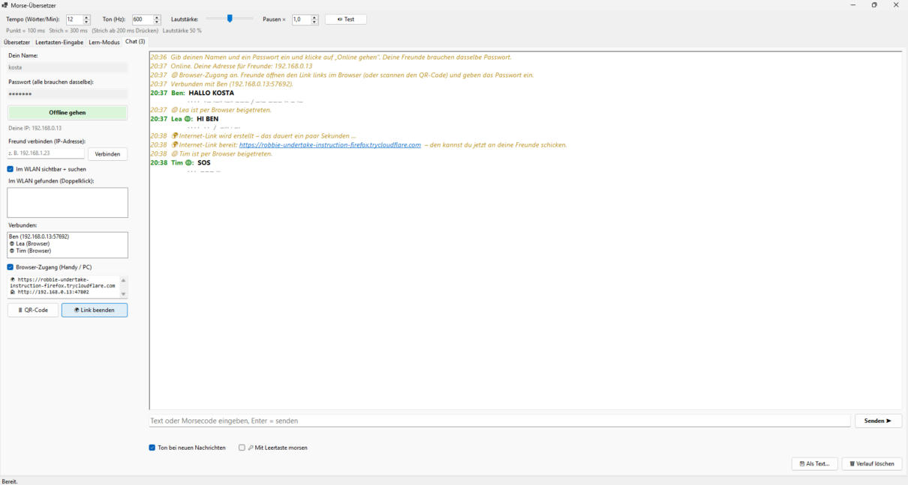

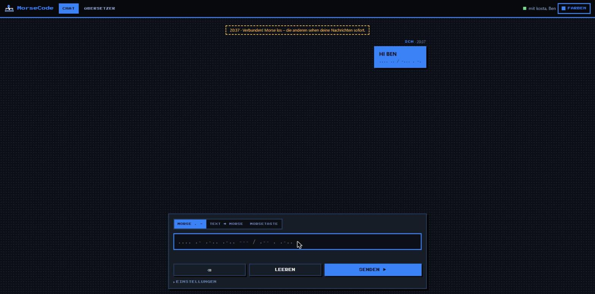

Ich hatte einige Fehler:
- Bei einem falschen Passwort hat man bei mir nichts gesehen.
- Im Browser stand oben nicht, wer neu dazugekommen ist.
- Wenn das Programm zweimal offen war, kam eine englische Fehlermeldung.
- Im kleinen Fenster hat eine Checkbox den Knopf „Als Text…“ verdeckt.
- Beim Morsen im Chat hat die Rücktaste nach einer Pause scheinbar nichts gemacht, weil sie zuerst eine unsichtbare Wortlücke `/` gelöscht hat.

Alle fünf Fehler sind behoben.

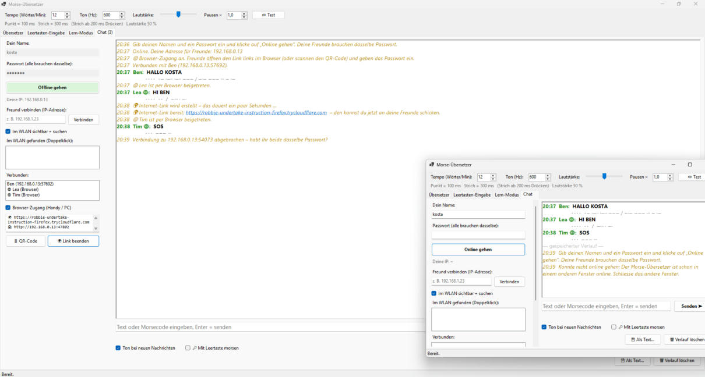

Gelernt habe ich:
- Eine TCP-Verbindung kann auch ohne Fehler zugehen. Darum muss man nach der `while`-Schleife prüfen, ob der Freund schon `hello` gesagt hat.
- Mit `catch (SocketException ex) when (...)` fängt man nur einen bestimmten Fehler ab, z. B. `AddressAlreadyInUse`.
- `-p:EnableCompressionInSingleFile=true` macht die `.exe` etwa halb so gross (72 MB statt 154 MB).

**Status:** fertig – WLAN, Browser, Internet-Link und Morsetaste im Chat funktionieren auf meinem PC. Mit echten Freunden und einem echten Handy habe ich es noch nicht getestet.

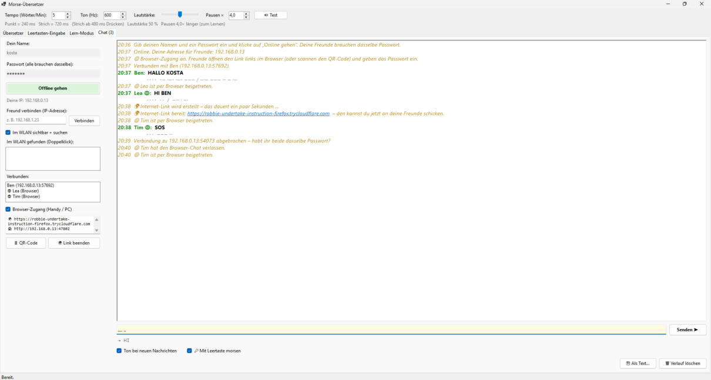

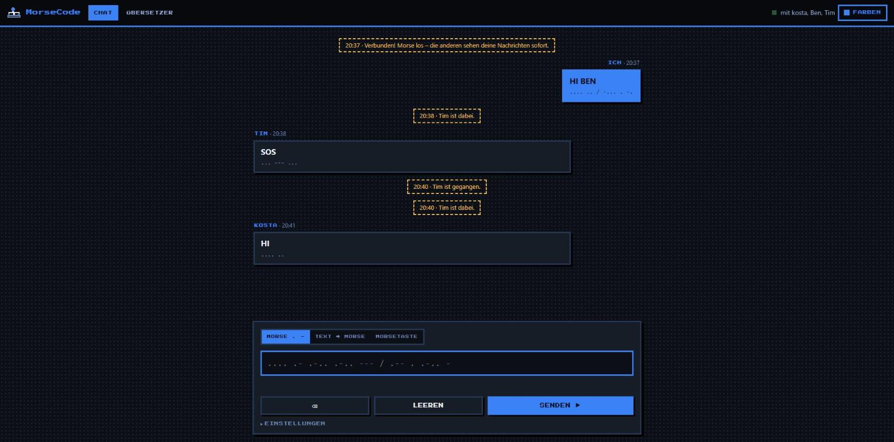

## Zusammenfassung
Von den 4 Arbeitspaketen habe ich drei ganz geschafft: Fehler beheben, Morsetaste im Chat und die Erklärung von `ChatNode.cs`. Die Erklärung steht in der [Code-Erklärung](https://github.com/MGK-onsta1/Morse-Uebersetzer/blob/main/CODE-ERKLAERUNG.md). Den Praxistest habe ich nur auf meinem PC mit Test-Freunden gemacht. Den Teil „selbst ohne KI ändern“ muss ich noch machen.

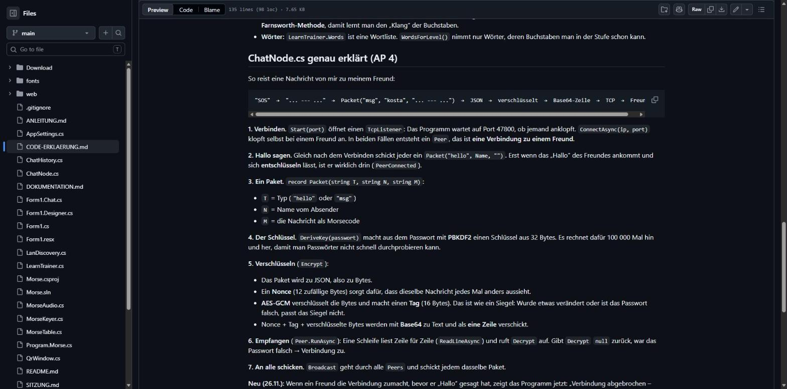

## Ausblick
Als Nächstes will ich den Chat endlich mit echten Freunden und Handys testen. Ausserdem will ich zeigen, dass ich `ChatNode.cs` verstehe, indem ich die Testfragen beantworte und selbst etwas ohne KI ändere.

## Nächstes Mal (4 Arbeitspakete)
- [x] **Praxistest mit Freunden:** Chat über WLAN, Handy-Browser und Internet-Link mit echten Geräten testen und Fehler notieren *(mit meinem iPhone, ohne Freunde)*
- [x] **Fehler beheben:** die gefundenen Fehler reparieren und eine neue `.exe` hochladen
- [x] **Code verstehen:** die 3 Testfragen zu `ChatNode.cs` in der Code-Erklärung beantworten *(die Antworten hat Claude geschrieben, nicht ich)*
- [x] **Selbst ändern:** Aufgabe 5 oder 6 aus der Code-Erklärung ohne KI lösen *(Aufgabe 6 hat Claude gelöst, also nicht ohne KI)*

# 27.11.2026 | Projekt: Morse-Übersetzer

## Heute
Ich habe den Chat mit meinem iPhone getestet. Im Schul-WLAN ging es nicht, weil die Schule das blockiert. Mit **mobilen Daten** und dem **Internet-Link** hat es geklappt. Danach habe ich die **Version 1.2** gemacht: **https://github.com/MGK-onsta1/Morse-Uebersetzer**

**Hilfe:** **Claude** (eine KI) hat mir sehr geholfen. Die 3 Testfragen und die Aufgabe 6 hat Claude gemacht, nicht ich.

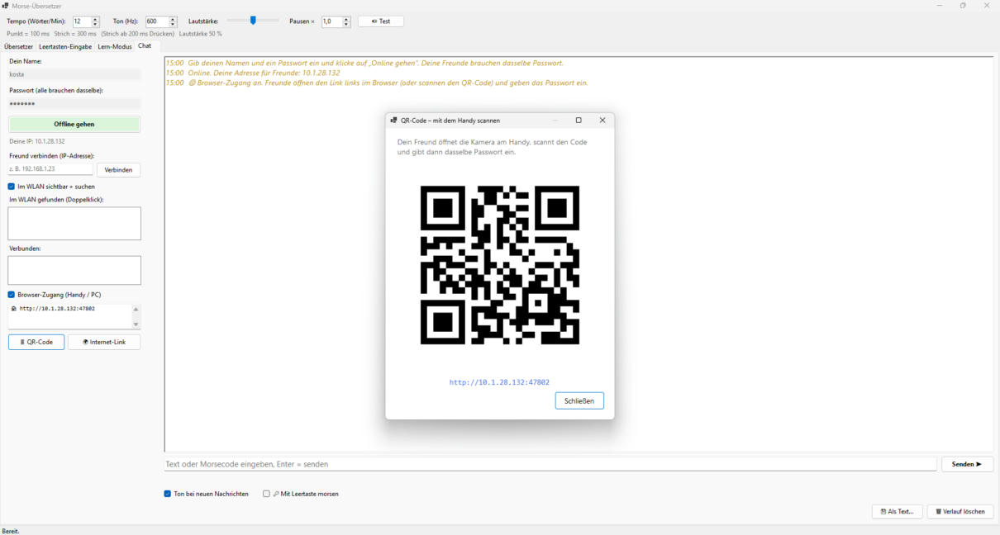

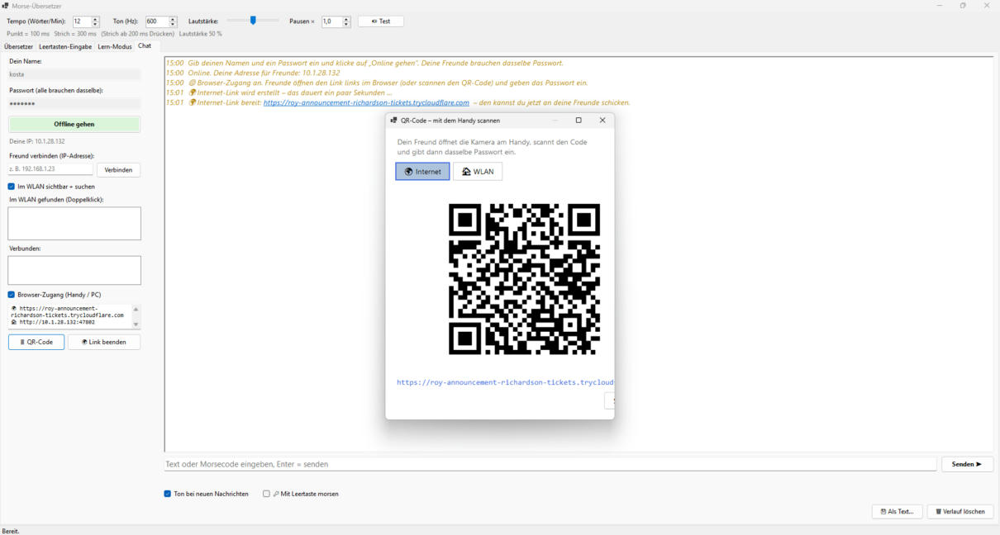

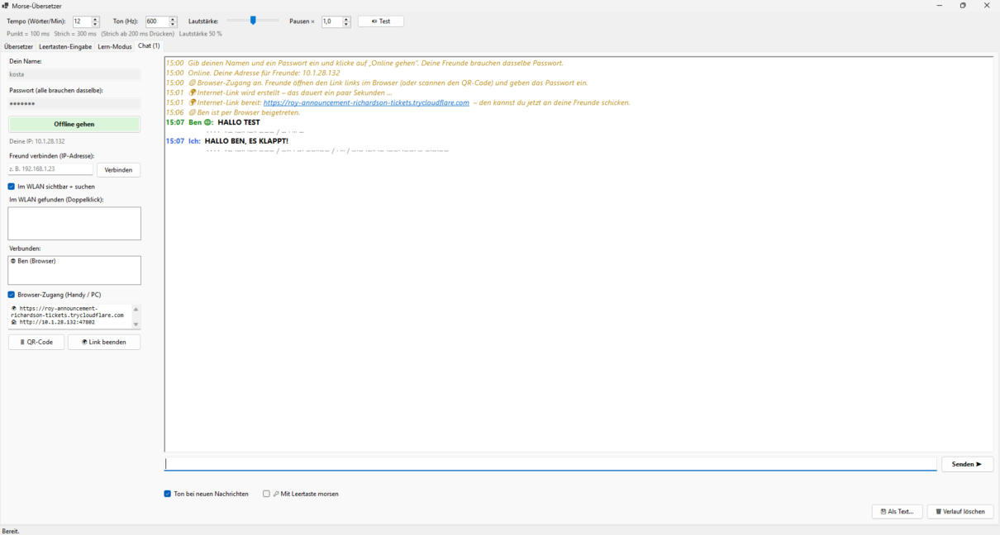

Fehler:
- Der lange Link im QR-Fenster war abgeschnitten.
- Es gab keinen Tipp zum Schul-WLAN.
- Am Handy stand nur „Keine Verbindung“.

Alle drei sind behoben.

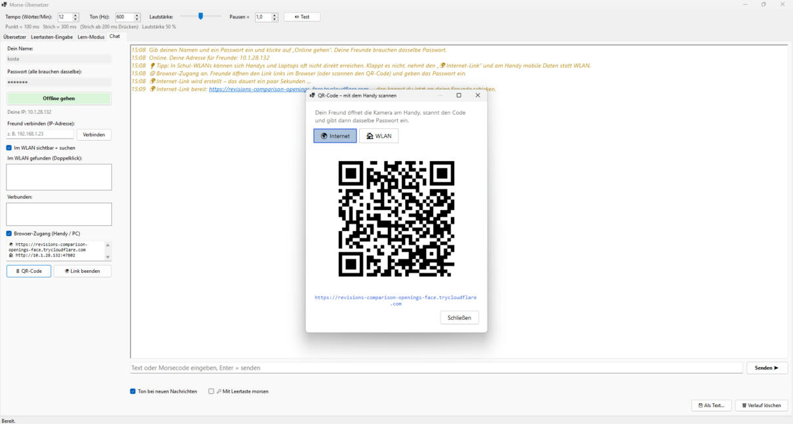

Gelernt habe ich:
- Schul-WLANs blockieren oft Verbindungen zwischen Geräten.
- Mit mobilen Daten geht es trotzdem.

**Status:** fertig – der Handy-Chat klappt. Mit Freunden habe ich es noch nicht getestet.

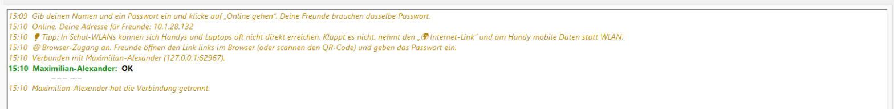

## Zusammenfassung
Alle 4 Arbeitspakete sind fertig. Den Test und die Fehler habe ich mit Claude gemacht. Die Testfragen und Aufgabe 6 hat Claude allein gemacht.

## Ausblick
Ich will die Antworten von Claude selbst verstehen und den Chat mit Freunden testen.

## Nächstes Mal (4 Arbeitspakete)
- [ ] **Antworten verstehen:** die 3 Antworten in eigenen Worten erklären
- [ ] **Selbst ändern:** Aufgabe 5 ohne KI lösen
- [ ] **Test mit Freunden:** mit 2 Freunden über den Internet-Link chatten
- [ ] **Fehler notieren:** aufschreiben, was nicht klappt
